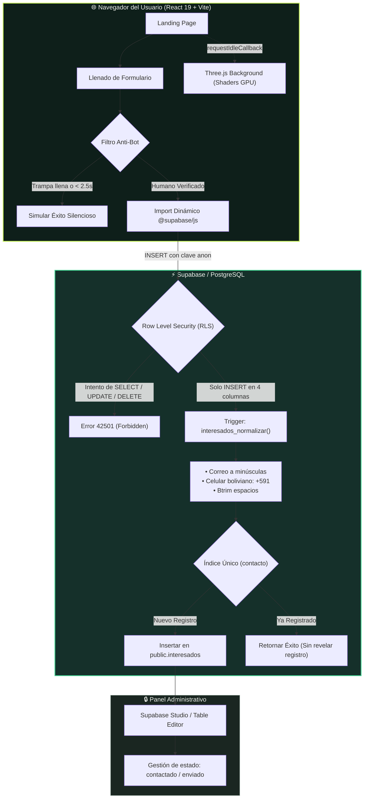

<div align="center">

# 🌿 Tuki — Registro Contable Personal

### *Control financiero intuitivo, ligero y sin fricciones.*

[](https://vitejs.dev/)
[](https://react.dev/)
[](https://www.typescriptlang.org/)
[](https://threejs.org/)
[](https://greensock.com/)
[](https://supabase.com/)
[](https://vercel.com/)

<p align="center">
  <b>Landing page interactiva de pre-registro y lista de espera para Tuki.</b><br>
  Diseñada con animaciones coreografiadas mediante GSAP, fondo de hebras de luz 3D en Three.js con shaders GLSL, celulares interactivos renderizados 100% en SVG/HTML accesible y una arquitectura zero-trust con Supabase y Row Level Security (RLS).
</p>

[✨ Propósito](#-visión-y-propósito) •
[📱 Experiencia Interactiva](#-experiencia-visual-y-storytelling) •
[📐 Arquitectura](#-arquitectura-y-flujo-de-datos) •
[💎 Planes y Precios](#-planes-y-precios) •
[🛠️ Stack Tecnológico](#-stack-tecnológico) •
[🔐 Seguridad RLS](#-seguridad-y-anti-spam-en-supabase) •
[🎨 Sistema de Diseño](#-sistema-de-diseño-y-tokens) •
[🚀 Inicio Rápido](#-guía-de-inicio-rápido)

---

</div>

## 📑 Tabla de Contenidos

- [🌿 Visión y Propósito](#-visión-y-propósito)
- [✨ Características Destacadas](#-características-destacadas)
- [📱 Experiencia Visual y Storytelling](#-experiencia-visual-y-storytelling)
- [📐 Arquitectura y Flujo de Datos](#-arquitectura-y-flujo-de-datos)
- [💎 Planes y Precios](#-planes-y-precios)
- [🛠️ Stack Tecnológico](#-stack-tecnológico)
- [🔐 Seguridad y Anti-Spam en Supabase](#-seguridad-y-anti-spam-en-supabase)
  - [Reglas RLS y Mínimo Privilegio](#reglas-rls-y-principio-de-mínimo-privilegio)
  - [Normalización y Prevención de Duplicados](#normalización-y-prevención-de-duplicados)
  - [Auditoría y Pruebas de Penetración](#auditoría-rápida-con-curl)
- [🎨 Sistema de Diseño y Tokens](#-sistema-de-diseño-y-tokens)
- [📂 Estructura del Repositorio](#-estructura-del-repositorio)
- [🚀 Guía de Inicio Rápido](#-guía-de-inicio-rápido)
  - [Requisitos Previos](#requisitos-previos)
  - [Instalación Local](#instalación-local)
  - [Variables de Entorno](#variables-de-entorno)
- [📦 Despliegue en Producción](#-despliegue-en-producción)

---

## 🌿 Visión y Propósito

> [!NOTE]
> **El Problema:** La mayoría de las personas anotan sus finanzas personales en servilletas, libretas o notas sueltas del celular, o intentan mantener hojas de cálculo complejas que terminan abandonando. A fin de mes, no saben con certeza a dónde fue a parar su dinero.

**Tuki** nace para simplificar el registro contable personal cotidiano:
- **Inmediato:** Registro de ingresos y gastos en cuestión de segundos desde el móvil.
- **Transparente:** Separación clara por cuentas (efectivo, bancos, ahorros) y control presupuestario con retroalimentación visual directa.
- **Accesible:** Diseñado para estudiantes, trabajadores dependientes y personas con ingresos variables que buscan claridad financiera sin complicaciones contables.

Esta **landing page** tiene como objetivo recibir y validar a los primeros usuarios interesados para el acceso de prueba, garantizando una experiencia visual de alto nivel y máxima protección de datos.

---

## ✨ Características Destacadas

| Característica | Descripción Técnica |
| :--- | :--- |
| 🎬 **Storytelling Basado en Scroll** | Al descender por la página, un teléfono central interactivo se ancla en pantalla mientras sus vistas internas transicionan fluidamente entre módulos sincronizados con el texto. |
| 📱 **Celulares 100% SVG/HTML** | Sin imágenes PNG/WebP pesadas. Las interfaces del teléfono se construyen mediante SVG vectorial y nodos DOM reales, asegurando nitidez retiniana y accesibilidad para lectores de pantalla. |
| 🌌 **Fondo 3D con Shaders GLSL** | Canvas de fondo animado en Three.js con curvas calculadas en GPU. Se ejecuta solo en tiempo de inactividad (`requestIdleCallback`) y se pausa fuera de vista para ahorrar batería. |
| 🛡️ **Seguridad Zero-Trust RLS** | La clave anónima del navegador **únicamente tiene permisos de inserción sobre 4 columnas**. Es matemáticamente imposible consultar o modificar datos de otros inscritos desde la web. |
| 🤖 **Protección Anti-Spam Dual** | Campo trampa (*honeypot*) invisible + verificación de tiempo de interacción humano mínimo (> 2.5s). A los bots se les simula éxito sin escribir en la base de datos. |
| ♿ **Accesibilidad Integral** | Cumplimiento semántico estricto, enlaces de salto (`saltar al contenido`), soporte de navegación por teclado y respeto absoluto a `prefers-reduced-motion`. |

---

## 📱 Experiencia Visual y Storytelling

La sección *"Así se ve Tuki"* guía al usuario a través de los cuatro pilares fundamentales de la aplicación mediante una coreografía interactiva:

```
┌────────────────────────────────────────────────────────────────────────┐
│                              DESKTOP VIEW                              │
│                                                                        │
│   [ Pasos del Storytelling ]                  [ Teléfono Fijo ]        │
│   1. Anota cada ingreso y gasto  ──►     ┌────────────────────────┐    │
│   2. Cada cuenta con su saldo    ──►     │  Transición dinámica   │    │
│   3. Un límite para cada gasto   ──►     │  de pantalla al hacer  │    │
│   4. Ordénalo a tu manera        ──►     │  scroll sincronizado   │    │
│                                          └────────────────────────┘    │
└────────────────────────────────────────────────────────────────────────┘
```

1. **Anota cada ingreso y gasto:** Registro rápido con monto, categoría y cuenta de origen. Visualización cromática intuitiva (**verde hoja** para dinero que entra, **coral** para dinero que sale).
2. **Cada cuenta con su saldo:** Visión consolidada de billeteras de efectivo, cuentas corrientes/ahorro bancarias y saldo global total.
3. **Un límite para cada gasto:** Presupuestos por categoría con medidores de avance porcentual y advertencias visuales inmediatas ante sobregiros.
4. **Ordénalo a tu manera:** Organización flexible mediante categorías personalizadas y marcadores contextuales (ej. `#universidad`, `#vacaciones`, `#casa`).

---

## 📐 Arquitectura y Flujo de Datos

El flujo de información fue diseñado priorizando la velocidad de carga inicial en dispositivos móviles y la estricta protección de privacidad:



---

## 💎 Planes y Precios

Los datos de suscripción se gestionan desde un **único archivo de verdad** ([`src/data/plans.ts`](file:///home/herberth/Proyectos/tuki-landing/src/data/plans.ts)). Cualquier cambio en precios o funciones se propaga automáticamente a los componentes visuales, el selector del formulario y el cálculo dinámico de ahorros:

| Plan | Inversión | Ciclo de Cobro | Duración | Beneficios Principales |
| :--- | :---: | :---: | :---: | :--- |
| **Gratis** | `Bs 0` | Sin costo | Sin vencimiento | Funciones esenciales para iniciar con anuncios incluidos. |
| **Compra única** | `Bs 19.90` | Pago único | Sin vencimiento | Elimina los anuncios permanentemente manteniendo los límites base. |
| **Premium mensual** | `Bs 9.90` | Cada 30 días | 30 días | Sin anuncios y acceso ilimitado a todas las herramientas avanzadas. |
| **Premium anual** | `Bs 79.90` | Cada 365 días | 365 días | Máximo ahorro *(equivale a ~8 meses de tarifa mensual: **ahorras Bs 38.90**)*. |

### Matriz Comparativa de Capacidades

| Capacidad | Plan Gratis | Plan Sin Anuncios | Planes Premium |
| :--- | :---: | :---: | :---: |
| **Registro de ingresos y gastos** | ✅ Sí | ✅ Sí | ✅ Sí |
| **Historial de movimientos completo** | ✅ Sí | ✅ Sí | ✅ Sí |
| **Categorías** | Básicas | Básicas | ✨ Personalizadas |
| **Cuentas simultáneas** | Hasta 3 | Hasta 3 | 🚀 Ilimitadas |
| **Marcadores (#tags)** | Hasta 5 | Hasta 5 | 🚀 Ilimitados |
| **Presupuestos activos** | Hasta 2 | Hasta 2 | 🚀 Ilimitados |
| **Experiencia sin anuncios** | ❌ Con anuncios | ✅ Sin anuncios | ✅ Sin anuncios |

---

## 🛠️ Stack Tecnológico

| Capa | Tecnología | Versión | Justificación Técnica |
| :--- | :--- | :---: | :--- |
| **Frontend Core** | [React](https://react.dev/) | `19.3` | Arquitectura basada en componentes funcionales modernos, hooks nativos y renderizado reactivo. |
| **Lenguaje** | [TypeScript](https://www.typescriptlang.org/) | `7.0` | Tipado estricto en datos de planes, contratos de validación de formularios y respuestas de base de datos. |
| **Bundler & Tooling** | [Vite](https://vitejs.dev/) | `8.3` | Compilación ultra veloz vía Rollup y servidor de desarrollo instantáneo con HMR nativo. |
| **Renderizado 3D** | [Three.js](https://threejs.org/) | `0.186` | Fondo inmersivo generado mediante un shader GLSL de hebras fluidas ejecutado en GPU. |
| **Animación & Scroll** | [GSAP](https://greensock.com/) + [Lenis](https://lenis.darkroom.engineering/) | `3.15` / `1.3` | Desplazamiento inercial suave y orquestación temporal de entradas por caracteres, parallax y fijación de mockups. |
| **Base de Datos** | [Supabase](https://supabase.com/) | `2.118` | PostgreSQL 15 administrado en la nube con validación a nivel de motor, triggers PL/pgSQL y Row Level Security. |
| **Tipografía** | Fontsource Variable | `5.3` | Fuentes de variable tipográfica (`Bricolage Grotesque` para titulares y `Onest` para textos) auto-alojadas. |
| **Despliegue** | [Vercel](https://vercel.com/) | Edge | CDN global de alto rendimiento y detección automática de compilación estática. |

---

## 🔐 Seguridad y Anti-Spam en Supabase

### Reglas RLS y Principio de Mínimo Privilegio

> [!IMPORTANT]
> Las variables `VITE_SUPABASE_URL` y `VITE_SUPABASE_ANON_KEY` son **públicas por diseño**. La seguridad no depende de ocultar las credenciales en el navegador, sino de las políticas a nivel de fila (**RLS**) implementadas en PostgreSQL ([`supabase/schema.sql`](file:///home/herberth/Proyectos/tuki-landing/supabase/schema.sql)).

1. **Permiso Único de Inserción:** El rol `anon` **solo** tiene concedido el privilegio `INSERT` exclusivamente sobre 4 columnas:
   ```sql
   grant insert (nombre, contacto, plan_interes, consentimiento)
     on public.interesados to anon;
   ```
2. **Denegación Total de Lectura y Modificación:** `SELECT`, `UPDATE` y `DELETE` están explícitamente revocados para `anon`, `authenticated` y `public`.
3. **Validación Declarativa en Motor:** Restricciones `CHECK` para validar longitud del nombre (2 a 80 caracteres), expresiones regulares de correo/teléfono y consistencia de planes permitidos.
4. **Protección contra Fuga de Identidad:** Cuando una persona introduce un contacto ya registrado, la interfaz informa éxito sin error para evitar que terceros comprueben si un correo o número ya forma parte de la lista de espera.

### Normalización y Prevención de Duplicados

Un trigger de base de datos (`interesados_normalizar`) sanitiza los datos antes del guardado:
- Convierte correos a minúsculas (`Usuario@Gmail.COM` → `usuario@gmail.com`).
- Remueve caracteres no numéricos en teléfonos y añade el código internacional boliviano `591` a números locales de 8 dígitos que comiencen con `6` o `7`.
- Un índice único (`interesados_contacto_unico`) rechaza colisiones a nivel de disco.

### Auditoría Rápida con cURL

Puedes verificar directamente las defensas del endpoint con los siguientes comandos:

<details>
<summary><b>🔍 Ver pruebas de penetración y verificación RLS</b></summary>

```bash
# Define tus variables de entorno públicas
URL="https://TU-PROYECTO.supabase.co"
KEY="tu-clave-anon"

# 1. Intento de Lectura (Debe responder error 42501 - Permiso Denegado, NUNCA datos)
curl -s "$URL/rest/v1/interesados?select=*" \
  -H "apikey: $KEY" \
  -H "Authorization: Bearer $KEY"

# 2. Intento de Eliminación (Debe ser rechazado inmediatamente)
curl -s -X DELETE "$URL/rest/v1/interesados?id=not.is.null" \
  -H "apikey: $KEY" \
  -H "Authorization: Bearer $KEY"

# 3. Intento de Modificación de Estado (Debe ser rechazado inmediatamente)
curl -s -X PATCH "$URL/rest/v1/interesados?id=not.is.null" \
  -H "apikey: $KEY" \
  -H "Authorization: Bearer $KEY" \
  -H "Content-Type: application/json" \
  -d '{"estado":"enviado"}'
```
</details>

---

## 🎨 Sistema de Diseño y Tokens

La estética visual de Tuki está construida sobre un sistema semántico de contraste optimizado:

| Token CSS | Muestra | Valor Hex | Significado y Aplicación |
| :--- | :---: | :---: | :--- |
| `--tinta` | `⬛` | `#0E1F1A` | Fondo oscuro primario (verde noche profundo). |
| `--tinta-2` | `⬛` | `#15302A` | Fondo de tarjetas y elementos elevados. |
| `--hoja` | `🟩` | `#C8F25A` | **Dinero que entra**, acciones primarias (CTA) e indicadores de balance positivo. |
| `--coral` | `🟧` | `#FF6A4D` | **Dinero que sale**, alertas de sobregiro y avisos críticos. |
| `--papel` | `⬜` | `#F1F4EE` | Texto de lectura principal y fondo para secciones claras. |
| `--bruma` | `◽` | `#8CA096` | Texto secundario, subtítulos y bordes sutiles. |

> [!TIP]
> **Accesibilidad de Movimiento:** Si el sistema operativo del usuario tiene activada la preferencia de reducción de movimiento (`prefers-reduced-motion: reduce`), Lenis se desactiva, GSAP anula las transiciones de scroll y Three.js dibuja una sola imagen estática en el canvas.

---

## 📂 Estructura del Repositorio

```text
tuki-landing/
├── public/
│   └── favicon.svg             # Isotipo oficial de Tuki en SVG
├── src/
│   ├── components/             # Secciones de la landing y componentes visuales
│   │   ├── Header.tsx          # Barra de navegación flotante con enlaces y CTA
│   │   ├── Hero.tsx            # Pantalla principal con titular orquestado y teléfonos flotantes
│   │   ├── QueEs.tsx           # Contexto del problema y propuesta de valor
│   │   ├── Historia.tsx        # Sección "Así se ve Tuki" con scroll sincronizado
│   │   ├── Planes.tsx          # Tabla de planes, comparativa y selector
│   │   ├── Registro.tsx        # Formulario con validación, honeypot y conexión Supabase
│   │   ├── Footer.tsx          # Pie de página y derechos
│   │   ├── Phone.tsx           # Mockup de teléfono celular vectorial SVG/HTML accesible
│   │   ├── Logo.tsx            # Logotipo oficial animable
│   │   └── Palabras.tsx        # Utilidad para animación de texto palabra por palabra
│   ├── data/
│   │   ├── plans.ts            # 🌟 ÚNICA fuente de verdad para planes, precios y funciones
│   │   └── mock.ts             # Datos simulados visibles en las pantallas de los celulares
│   ├── screens/                # Vistas renderizadas dentro de los celulares interactivos
│   │   └── Pantallas.tsx       # Movimientos, Cuentas, Presupuestos, Marcadores y Resumen
│   ├── lib/                    # Lógica de soporte desacoplada
│   │   ├── format.ts           # Formateadores de moneda (Bs) y valores numéricos
│   │   ├── hebras.ts           # Fondo 3D en Three.js con GLSL shaders (Lazy load)
│   │   ├── hooks.ts            # Hooks personalizados (useMediaQuery, etc.)
│   │   ├── motion.ts           # Configuración de GSAP, ScrollTrigger y Lenis
│   │   ├── supabase.ts         # Cliente de conexión bajo demanda a Supabase
│   │   └── validation.ts       # Reglas de validación para correo y celular
│   ├── styles/
│   │   └── global.css          # Variables CSS, tipografías y estilos base
│   ├── App.tsx                 # Ensamblador maestro de la página
│   └── main.tsx                # Punto de entrada de la aplicación
├── supabase/
│   └── schema.sql              # Esquema de BD, validaciones CHECK, trigger RLS e índices
├── .env.example                # Plantilla de variables de entorno públicas
├── index.html                  # Plantilla HTML base con preloads de fuentes
├── package.json                # Definición de dependencias y scripts
├── tsconfig.json               # Configuración del compilador TypeScript
├── vercel.json                 # Reglas de reescritura de rutas para despliegue en Vercel
└── vite.config.ts              # Configuración de compilación en Vite
```

---

## 🚀 Guía de Inicio Rápido

### Requisitos Previos

- [Node.js](https://nodejs.org/) `>= 20.0.0`
- Gestor de paquetes `npm` (incluido en Node)

### Instalación Local

1. **Clonar el repositorio:**
   ```bash
   git clone https://github.com/tu-usuario/tuki-landing.git
   cd tuki-landing
   ```

2. **Instalar dependencias:**
   ```bash
   npm install
   ```

3. **Configurar variables de entorno:**
   ```bash
   cp .env.example .env
   ```
   Abre el archivo `.env` y completa los valores obtenidos en tu panel de Supabase (*Project Settings → API*):
   ```ini
   VITE_SUPABASE_URL=https://TU-PROYECTO.supabase.co
   VITE_SUPABASE_ANON_KEY=tu-clave-anon-o-publishable
   ```

4. **Configurar la base de datos:**
   - Ve a tu proyecto en [Supabase Console](https://supabase.com/dashboard) → **SQL Editor**.
   - Abre y copia el contenido íntegro de [`supabase/schema.sql`](file:///home/herberth/Proyectos/tuki-landing/supabase/schema.sql).
   - Haz clic en **Run**. *(El script es totalmente idempotente y puede ejecutarse múltiples veces de manera segura)*.

5. **Iniciar el servidor de desarrollo:**
   ```bash
   npm run dev
   ```
   Abre tu navegador en `http://localhost:5173`.

### Scripts Disponibles

| Comando | Acción |
| :--- | :--- |
| `npm run dev` | Inicia el servidor de desarrollo en local con Hot Module Replacement (HMR). |
| `npm run build` | Ejecuta la comprobación estricta de TypeScript y genera el bundle de producción en `dist/`. |
| `npm run preview` | Levanta un servidor local para inspeccionar la versión final compilada. |
| `npm run typecheck` | Comprueba tipos en todo el proyecto mediante `tsc --noEmit` sin compilar. |

---

## 📦 Despliegue en Producción

### Despliegue en Vercel

1. Sube los cambios a tu repositorio remoto en GitHub.
2. Ingresa a [Vercel](https://vercel.com/) y selecciona **Add New → Project**.
3. Importa el repositorio de `tuki-landing`. Vercel detectará la configuración de Vite automáticamente:
   - **Framework Preset:** Vite
   - **Build Command:** `npm run build`
   - **Output Directory:** `dist`
4. En la sección **Environment Variables**, registra:
   - `VITE_SUPABASE_URL`
   - `VITE_SUPABASE_ANON_KEY`
5. Pulsa **Deploy**. Cada nuevo commit en la rama principal generará automáticamente un despliegue continuo.

---

<div align="center">

Hecho con precisión y cariño para las finanzas de Bolivia y el mundo 🇧🇴

© 2026 Tuki. Todos los derechos reservados.

</div>
