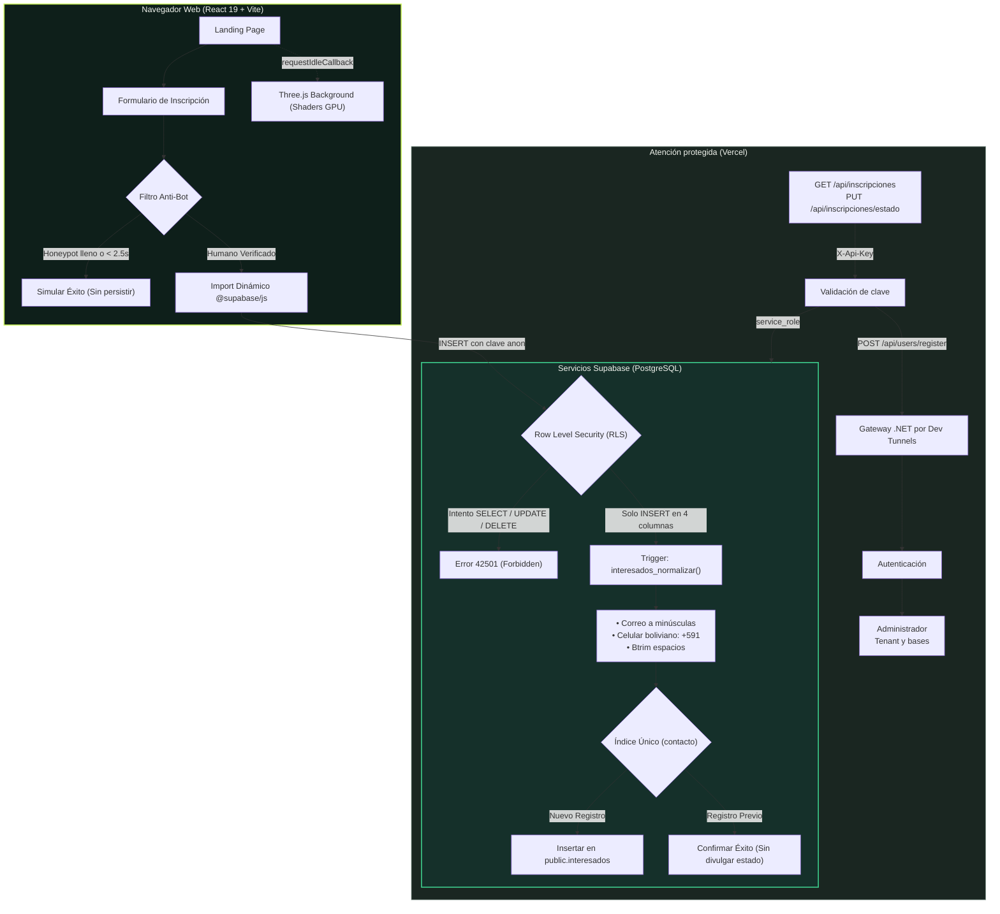

<div align="center">

  

  # Tuki — Registro Contable Personal

  <p><strong>Control financiero intuitivo, ligero y sin fricciones.</strong></p>

  [](https://vitejs.dev/)
  [](https://react.dev/)
  [](https://www.typescriptlang.org/)
  [](https://threejs.org/)
  [](https://greensock.com/)
  [](https://supabase.com/)
  [](https://vercel.com/)

  <p>
    Landing page interactiva de pre-registro y lista de espera para Tuki.<br>
    Construida con animaciones coreografiadas en GSAP, fondo procedural en Three.js con shaders GLSL personalizados, celulares renderizados en SVG y HTML accesible, y arquitectura zero-trust sobre Supabase con Row Level Security (RLS).
  </p>

  <p>
    <a href="#visión-y-propósito">Propósito</a> &bull;
    <a href="#experiencia-visual-y-storytelling">Experiencia Interactiva</a> &bull;
    <a href="#arquitectura-y-flujo-de-datos">Arquitectura</a> &bull;
    <a href="#planes-y-precios">Planes y Precios</a> &bull;
    <a href="#stack-tecnológico">Stack Tecnológico</a> &bull;
    <a href="#seguridad-y-anti-spam-en-supabase">Seguridad RLS</a> &bull;
    <a href="#sistema-de-diseño-y-tokens">Sistema de Diseño</a> &bull;
    <a href="#guía-de-inicio-rápido">Inicio Rápido</a>
  </p>

  <hr>

</div>

## Tabla de Contenidos

- [Visión y Propósito](#visión-y-propósito)
- [Características Principales](#características-principales)
- [Experiencia Visual y Storytelling](#experiencia-visual-y-storytelling)
- [Arquitectura y Flujo de Datos](#arquitectura-y-flujo-de-datos)
- [Planes y Precios](#planes-y-precios)
- [Stack Tecnológico](#stack-tecnológico)
- [Seguridad y Anti-Spam en Supabase](#seguridad-y-anti-spam-en-supabase)
  - [Reglas RLS y Principio de Mínimo Privilegio](#reglas-rls-y-principio-de-mínimo-privilegio)
  - [Normalización y Prevención de Duplicados](#normalización-y-prevención-de-duplicados)
  - [Auditoría Rápida con cURL](#auditoría-rápida-con-curl)
- [Sistema de Diseño y Tokens](#sistema-de-diseño-y-tokens)
- [Estructura del Repositorio](#estructura-del-repositorio)
- [Guía de Inicio Rápido](#guía-de-inicio-rápido)
  - [Requisitos Previos](#requisitos-previos)
  - [Instalación Local](#instalación-local)
  - [Variables de Entorno](#variables-de-entorno)
- [Despliegue en Producción](#despliegue-en-producción)

---

## Visión y Propósito

> [!NOTE]
> **El Problema:** La mayoría de las personas anotan sus finanzas personales en libretas, notas dispersas en el móvil o en hojas de cálculo complejas que terminan abandonando. Al finalizar el mes, se pierde la trazabilidad de los gastos.

**Tuki** centraliza y sistematiza el registro contable personal:
- **Inmediato:** Registro de ingresos y gastos en segundos desde el navegador móvil.
- **Transparente:** Control consolidado por cuentas (efectivo, entidades financieras, fondos de ahorro) y seguimiento presupuestario con retroalimentación visual directa.
- **Accesible:** Diseñado para estudiantes, profesionales dependientes e independientes con ingresos variables que requieren claridad contable sin fricciones técnicas.

Esta **landing page** tiene como objetivo recibir y validar a los primeros usuarios interesados para el acceso de prueba, garantizando una presentación visual óptima y protección rigurosa de los datos recolectados.

---

## Características Principales

| Módulo | Especificación Técnica |
| :--- | :--- |
| **Storytelling Basado en Scroll** | Al avanzar en la lectura, un dispositivo móvil central permanece anclado en pantalla mientras sus pantallas internas transicionan fluidamente entre vistas coordinadas con el texto explicativo. |
| **Mockups en SVG y HTML Nativo** | Sin imágenes estáticas pesadas (PNG o WebP). Las interfaces del teléfono se generan íntegramente mediante vectores SVG y estructura DOM accesible, garantizando nitidez vectorial y compatibilidad con lectores de pantalla. |
| **Fondo 3D con Shaders GLSL** | Canvas tridimensional interactivo desarrollado en Three.js con curvas calculadas directamente en GPU. Se inicializa en periodos de inactividad (`requestIdleCallback`) y pausa su renderizado cuando no está visible. |
| **Seguridad Zero-Trust RLS** | La clave anónima del navegador dispone únicamente de privilegios de inserción restringidos a 4 columnas. Es estructuralmente inviable consultar, alterar o eliminar registros de otros usuarios desde la aplicación cliente. |
| **Filtro Anti-Spam de Doble Capa** | Trampa invisible (*honeypot*) combinada con un umbral de tiempo mínimo de interacción humana (> 2.5s). A agentes automatizados se les simula una respuesta satisfactoria sin persistir registros en base de datos. |
| **Accesibilidad Estricta** | Estructura semántica, enlaces de salto directo al contenido principal, navegación completa mediante teclado y desactivación automática de animaciones bajo `prefers-reduced-motion`. |

---

## Experiencia Visual y Storytelling

La sección *"Así se ve Tuki"* guía al visitante a través de los cuatro pilares fundamentales de la aplicación mediante una secuencia interactiva:

```
┌────────────────────────────────────────────────────────────────────────┐
│                              VISTA ESCRITORIO                          │
│                                                                        │
│   [ Pasos del Storytelling ]                  [ Dispositivo Anclado ]  │
│   1. Anota cada ingreso y gasto  -->     ┌────────────────────────┐    │
│   2. Cada cuenta con su saldo    -->     │  Transición dinámica   │    │
│   3. Un límite para cada gasto   -->     │  de pantalla durante   │    │
│   4. Ordénalo a tu manera        -->     │  el desplazamiento     │    │
│                                          └────────────────────────┘    │
└────────────────────────────────────────────────────────────────────────┘
```

1. **Anota cada ingreso y gasto:** Registro rápido con monto, categoría y cuenta de origen. Identificación cromática inmediata (verde lima para ingresos, coral para gastos).
2. **Cada cuenta con su saldo:** Vista consolidada de billeteras de efectivo, cuentas corrientes o cajas de ahorro, y cálculo en tiempo real del patrimonio disponible.
3. **Un límite para cada gasto:** Presupuestos por categoría con medidores de avance porcentual y advertencias visuales inmediatas ante sobregiros.
4. **Ordénalo a tu manera:** Organización flexible mediante categorías personalizadas y marcadores contextuales (por ejemplo, `#universidad`, `#vacaciones`, `#casa`).

---

## Arquitectura y Flujo de Datos

El flujo de información fue diseñado priorizando la velocidad de carga inicial en dispositivos móviles y la estricta protección de privacidad:



---

## Planes y Precios

Los datos de suscripción se gestionan desde un único archivo de configuración ([`src/data/plans.ts`](file:///home/herberth/Proyectos/tuki-landing/src/data/plans.ts)). Cualquier modificación de importes o características se propaga automáticamente a los componentes de visualización, el selector del formulario y la función de cálculo de ahorros:

| Plan | Inversión | Ciclo de Cobro | Duración | Beneficios Principales |
| :--- | :---: | :---: | :---: | :--- |
| **Gratis** | `Bs 0` | Sin costo | Sin vencimiento | Funciones esenciales para comenzar. Incluye anuncios. |
| **Compra única** | `Bs 19.90` | Pago único | Sin vencimiento | Elimina los anuncios permanentemente conservando los límites base. |
| **Premium mensual** | `Bs 9.90` | Cada 30 días | 30 días | Sin anuncios y acceso ilimitado a todas las herramientas avanzadas. |
| **Premium anual** | `Bs 79.90` | Cada 365 días | 365 días | Tarifa preferencial: equivale a ~8 meses de tarifa mensual (*ahorro de Bs 38.90*). |

### Matriz Comparativa de Capacidades

| Capacidad | Plan Gratis | Plan Sin Anuncios | Planes Premium |
| :--- | :---: | :---: | :---: |
| **Registro de ingresos y gastos** | Sí | Sí | Sí |
| **Historial de movimientos completo** | Sí | Sí | Sí |
| **Categorías** | Básicas | Básicas | Personalizadas |
| **Cuentas simultáneas** | Hasta 3 | Hasta 3 | Ilimitadas |
| **Marcadores (#etiquetas)** | Hasta 5 | Hasta 5 | Ilimitados |
| **Presupuestos activos** | Hasta 2 | Hasta 2 | Ilimitados |
| **Experiencia sin anuncios** | Con anuncios | Sin anuncios | Sin anuncios |

---

## Stack Tecnológico

| Capa | Tecnología | Versión | Justificación Técnica |
| :--- | :--- | :---: | :--- |
| **Frontend Core** | [React](https://react.dev/) | `19.3` | Arquitectura basada en componentes funcionales modernos, hooks nativos y renderizado reactivo. |
| **Lenguaje** | [TypeScript](https://www.typescriptlang.org/) | `7.0` | Tipado estricto en datos de planes, contratos de validación de formularios y respuestas de base de datos. |
| **Bundler & Tooling** | [Vite](https://vitejs.dev/) | `8.3` | Compilación veloz basada en Rollup y servidor de desarrollo con Hot Module Replacement (HMR). |
| **Renderizado 3D** | [Three.js](https://threejs.org/) | `0.186` | Fondo inmersivo generado mediante un shader GLSL de hebras fluidas ejecutado directamente en la GPU. |
| **Animación & Scroll** | [GSAP](https://greensock.com/) + [Lenis](https://lenis.darkroom.engineering/) | `3.15` / `1.3` | Desplazamiento inercial suave y orquestación temporal de entradas por caracteres, parallax y fijación de mockups. |
| **Base de Datos** | [Supabase](https://supabase.com/) | `2.118` | Instancia de PostgreSQL 15 en la nube con validación a nivel de motor, triggers PL/pgSQL y Row Level Security. |
| **Tipografía** | Fontsource Variable | `5.3` | Fuentes de variable tipográfica (`Bricolage Grotesque` para titulares y `Onest` para textos) auto-alojadas. |
| **Despliegue** | [Vercel](https://vercel.com/) | SPA + Node.js Functions | CDN para el sitio estático y funciones de servidor para atender inscripciones. |

---

## Seguridad y Anti-Spam en Supabase

### Reglas RLS y Principio de Mínimo Privilegio

> [!IMPORTANT]
> Las variables `VITE_SUPABASE_URL` y `VITE_SUPABASE_ANON_KEY` son **públicas por diseño**. La seguridad no depende de ocultar las credenciales en el cliente web, sino de las políticas a nivel de fila (**RLS**) implementadas en PostgreSQL ([`supabase/schema.sql`](file:///home/herberth/Proyectos/tuki-landing/supabase/schema.sql)).

1. **Permiso Exclusivo de Inserción:** El rol público `anon` únicamente tiene autorizado el privilegio `INSERT` sobre 4 columnas:
   ```sql
   grant insert (nombre, contacto, plan_interes, consentimiento)
     on public.interesados to anon;
   ```
2. **Denegación de Lectura y Modificación:** Las operaciones `SELECT`, `UPDATE` y `DELETE` se encuentran estrictamente revocadas para los roles `anon`, `authenticated` y `public`.
3. **Validación Declarativa en el Motor:** Restricciones `CHECK` para verificar la longitud del nombre (2 a 80 caracteres), expresiones regulares para formato de correo y celular, y planes permitidos.
4. **Protección contra Enumeración de Contactos:** Cuando un usuario remite un contacto ya existente, la interfaz simula una confirmación satisfactoria para evitar que actores externos deduzcan si un correo o número telefónico ya fue registrado.

### Funciones de servidor para atender inscripciones

Vercel publica `GET /api/inscripciones` y `PUT /api/inscripciones/estado` como
funciones de servidor. Ambas exigen `X-Api-Key`; usan `SUPABASE_SERVICE_ROLE_KEY`
solo en el servidor para consultar o actualizar un registro. La ruta de atención
no debe usar esas credenciales desde el navegador ni guardarlas en
`localStorage` o `sessionStorage`.

La interfaz de operadores está disponible en `/atencion`. Esa ruta por sí sola
no autentica al operador: las funciones API son las que validan la clave. La
pantalla mantiene la clave solo en memoria mientras está abierta y enmascara por
defecto los datos personales, el tenant ID y la contraseña temporal; el operador
puede revelarlos manualmente cuando sea necesario.

Al marcar una inscripción como atendida, la función llama al Gateway .NET en
`{ADMIN_BASE_URL}/api/users/register`. Ese servicio genera una contraseña
temporal y la devuelve una sola vez; la landing no la persiste ni la registra
en logs. Ante un `502`, verificar si la cuenta llegó a crearse antes de reintentar.

Ejecuta `npm test` desde la raíz de `tuki-landing` para correr las pruebas de
normalización y de las funciones API. La suite de API usa mocks en memoria para
Supabase y el Gateway, incluida una respuesta con contactos duplicados que no
puede producirse con el índice único actual. No necesita secretos ni modifica
datos reales; no sustituye una prueba de integración con los servicios desplegados.

### Normalización y Prevención de Duplicados

Un disparador en base de datos (`interesados_normalizar`) sanitiza los datos previo a la inserción:
- Convierte correos electrónicos a minúsculas (`Usuario@Servidor.COM` → `usuario@servidor.com`).
- Elimina caracteres no numéricos en números de contacto y antepone el código de país boliviano `591` a números locales de 8 dígitos iniciados en `6` o `7`.
- Un índice único (`interesados_contacto_unico`) descarta entradas redundantes a nivel de almacenamiento.

### Auditoría Rápida con cURL

Las políticas de seguridad del endpoint pueden auditarse directamente mediante la consola:

<details>
<summary><b>Ver pruebas de penetración y verificación RLS</b></summary>

```bash
# Variables de entorno públicas
URL="https://TU-PROYECTO.supabase.co"
KEY="tu-clave-anon"

# 1. Intento de Lectura (Debe responder error 42501 - Permiso Denegado, nunca datos)
curl -s "$URL/rest/v1/interesados?select=*" \
  -H "apikey: $KEY" \
  -H "Authorization: Bearer $KEY"

# 2. Intento de Eliminación (Debe ser rechazado inmediatamente)
curl -s -X DELETE "$URL/rest/v1/interesados?id=not.is.null" \
  -H "apikey: $KEY" \
  -H "Authorization: Bearer $KEY"

# 3. Intento de Modificación de Estado (Debe ser rechazado inmediatamente)
curl -s -X PATCH "$URL/rest/v1/interesados?id=not.is.null" \
  -H "apikey: $KEY" \
  -H "Authorization: Bearer $KEY" \
  -H "Content-Type: application/json" \
  -d '{"estado":"atendido"}'
```
</details>

---

## Sistema de Diseño y Tokens

La identidad visual de Tuki está sustentada en un sistema semántico de contraste:

| Token CSS | Código Hex | Rol Semántico y Aplicación |
| :--- | :---: | :--- |
| `--tinta` | `#0E1F1A` | Fondo oscuro principal (verde noche). |
| `--tinta-2` | `#15302A` | Fondo de tarjetas y contenedores elevados. |
| `--hoja` | `#C8F25A` | Dinero que entra, llamadas a la acción principales y saldos positivos. |
| `--coral` | `#FF6A4D` | Dinero que sale, límites de presupuesto superados y alertas. |
| `--papel` | `#F1F4EE` | Texto principal de lectura y fondos de contraste claro. |
| `--bruma` | `#8CA096` | Texto secundario, subtítulos y delimitadores de sección. |

> [!TIP]
> **Accesibilidad y Rendimiento:** Cuando el sistema operativo tiene activa la directiva de reducción de movimiento (`prefers-reduced-motion: reduce`), Lenis se suspende, GSAP prescinde de las transiciones de scroll y Three.js produce un único fotograma estático en el canvas.

---

## Estructura del Repositorio

```text
tuki-landing/
├── public/
│   └── favicon.svg             # Logotipo oficial de Tuki en formato SVG vectorial
├── src/
│   ├── components/             # Secciones de la página y piezas de interfaz
│   │   ├── Header.tsx          # Navegación flotante con enlaces y llamada a la acción
│   │   ├── Hero.tsx            # Pantalla inicial con titular orquestado y teléfonos móviles
│   │   ├── QueEs.tsx           # Planteamiento del problema y propuesta de valor
│   │   ├── Historia.tsx        # Sección interactiva con cambio dinámico de pantallas
│   │   ├── Planes.tsx          # Tabla de tarifas, comparativa y selector interactivo
│   │   ├── Registro.tsx        # Formulario con validación, trampa anti-bot y Supabase
│   │   ├── Footer.tsx          # Pie de página y créditos legales
│   │   ├── Phone.tsx           # Mockup de teléfono celular en SVG y HTML accesible
│   │   ├── Logo.tsx            # Logotipo de marca animable
│   │   └── Palabras.tsx        # Animación secuencial de titulares palabra por palabra
│   ├── data/
│   │   ├── plans.ts            # Fuente de verdad única para planes, precios y funciones
│   │   └── mock.ts             # Datos de demostración renderizados en los dispositivos
│   ├── screens/                # Vistas internas dibujadas dentro de los celulares
│   │   └── Pantallas.tsx       # Movimientos, Cuentas, Presupuestos, Marcadores y Resumen
│   ├── lib/                    # Utilidades y servicios desacoplados
│   │   ├── format.ts           # Formateadores numéricos y de moneda (Bs)
│   │   ├── hebras.ts           # Fondo 3D procedural en Three.js con GLSL (Lazy load)
│   │   ├── hooks.ts            # Hooks reactivos (detección de media queries, etc.)
│   │   ├── motion.ts           # Configuración central de GSAP, ScrollTrigger y Lenis
│   │   ├── supabase.ts         # Integración y envío asíncrono hacia Supabase
│   │   ├── inscripciones.ts    # Normalización y validación de contactos
│   │   └── validation.ts       # Esquemas de validación de correo y contacto telefónico
│   ├── styles/
│   │   └── global.css          # Variables CSS, tipografías globales y estilos base
│   ├── App.tsx                 # Ensamblador principal de la aplicación
│   └── main.tsx                # Punto de entrada de React
├── api/
│   ├── inscripciones.ts        # Consulta protegida de inscripciones
│   └── inscripciones/
│       └── estado.ts           # Actualización y aprovisionamiento de usuario/tenant
├── supabase/
│   └── schema.sql              # Esquema de base de datos, validaciones CHECK y RLS
├── .env.example                # Plantilla de variables públicas y server-only
├── index.html                  # Documento HTML base con precarga de fuentes
├── package.json                # Especificación de paquetes y scripts de ejecución
├── tsconfig.json               # Configuración del compilador TypeScript
├── vercel.json                 # Reglas de enrutamiento para despliegue en Vercel
└── vite.config.ts              # Configuración de empaquetado con Vite
```

---

## Guía de Inicio Rápido

### Requisitos Previos

- [Node.js](https://nodejs.org/) `>= 20.0.0`
- Gestor de paquetes `npm`

### Instalación Local

1. **Clonar el repositorio:**
   ```bash
   git clone https://github.com/tu-usuario/tuki-landing.git
   cd tuki-landing
   ```

2. **Instalar dependencias:**
   ```bash
   npm install
   ```

3. **Configurar variables de entorno:**
   ```bash
   cp .env.example .env
   ```
   Completar los valores obtenidos en la consola de Supabase (*Project Settings → API*):
   ```ini
   VITE_SUPABASE_URL=https://TU-PROYECTO.supabase.co
   VITE_SUPABASE_ANON_KEY=tu-clave-anon-o-publishable

   # Solo para funciones de servidor; nunca uses el prefijo VITE_.
   ADMIN_BASE_URL=http://localhost:5005
   SUPABASE_URL=https://TU-PROYECTO.supabase.co
   SUPABASE_SERVICE_ROLE_KEY=tu-clave-service-role
   LANDING_API_KEY=define-una-clave-aleatoria-larga
   ```
   `SUPABASE_SERVICE_ROLE_KEY` y `LANDING_API_KEY` son secretos: no los subas al
   repositorio ni los uses desde el navegador. `npm run dev` sirve el frontend;
   las funciones API se ejecutan en Vercel o con Vercel CLI (`npx vercel dev`).

4. **Configurar la base de datos:**
   - Acceder a [Supabase Console](https://supabase.com/dashboard) → **SQL Editor**.
   - Pegar el contenido íntegro de [`supabase/schema.sql`](file:///home/herberth/Proyectos/tuki-landing/supabase/schema.sql).
   - Ejecutar la sentencia (**Run**). El script es idempotente y seguro ante ejecuciones sucesivas.

5. **Iniciar el servidor de desarrollo:**
   ```bash
   npm run dev
   ```
   La aplicación estará disponible en `http://localhost:5173`.

### Scripts Disponibles

| Comando | Acción |
| :--- | :--- |
| `npm run dev` | Inicia el entorno local de desarrollo con recarga en caliente (HMR). |
| `npm run build` | Comprueba tipos con TypeScript y compila los artefactos de producción en `dist/`. |
| `npm run preview` | Sirve localmente los archivos compilados para validación previa al despliegue. |
| `npm run typecheck` | Ejecuta la comprobación estricta de tipos sin emitir archivos (`tsc --noEmit`). |
| `npm test` | Prueba la normalización y validación de contactos. |

---

## Despliegue en Producción

### Despliegue en Vercel

1. Publicar el repositorio en GitHub.
2. Ingresar a [Vercel](https://vercel.com/) y seleccionar **Add New → Project**.
3. Importar el repositorio `tuki-landing`. Vercel detectará la configuración de Vite automáticamente:
   - **Framework Preset:** Vite
   - **Build Command:** `npm run build`
   - **Output Directory:** `dist`
4. En **Environment Variables**, incorporar:
   - `VITE_SUPABASE_URL`
   - `VITE_SUPABASE_ANON_KEY`
   - `SUPABASE_URL`
   - `SUPABASE_SERVICE_ROLE_KEY` (solo servidor)
   - `LANDING_API_KEY` (solo servidor)
   - `ADMIN_BASE_URL` (URL HTTPS activa del Gateway por Dev Tunnels)
5. Ejecutar **Deploy**.

---

<div align="center">

Desarrollado para la gestión financiera personal en Bolivia y la región.

&copy; 2026 Tuki. Todos los derechos reservados.

</div>
